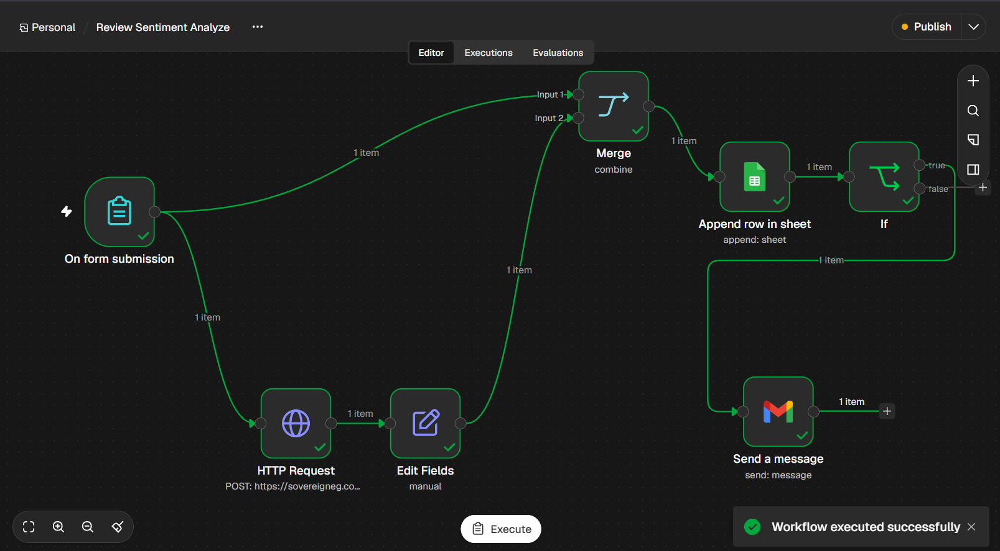
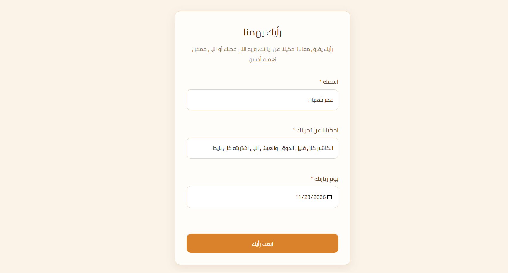
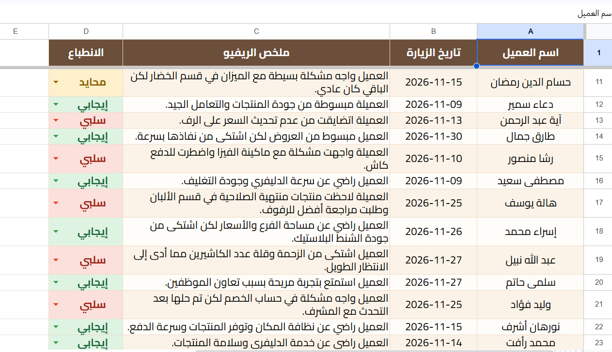
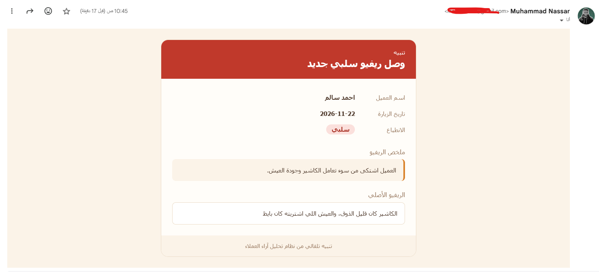

# Customer Review Analysis

An n8n workflow that collects customer reviews for a supermarket through an Arabic web form, uses AI to summarize each review and classify its sentiment, saves everything to Google Sheets, and emails the store owner an alert whenever a review is negative.

## Workflow



## Demo

### 1. Customer submits a review


### 2. Confirmation page


### 3. Review saved with an AI summary and sentiment


### 4. Owner receives an alert for negative reviews


## How It Works

1. **Form Trigger** shows a custom-styled Arabic (RTL, mobile-friendly) form titled "رأيك يهمنا" with three required fields: the customer's name, their experience, and the visit date.
2. **HTTP Request** sends the review to an OpenAI-compatible chat completions API (`gpt-4o-mini`, temperature 0, JSON output). The system prompt asks for exactly two fields:
   - `summary`: one short sentence in simple Arabic.
   - `sentiment`: one of `إيجابي` (positive), `سلبي` (negative), or `محايد` (neutral).
3. **Edit Fields** parses the JSON response into two clean fields: the summary and the sentiment.
4. **Merge** combines the original form data with the AI result by position.
5. **Google Sheets** appends one row per review.
6. **If** checks whether the sentiment is `سلبي`.
7. **Gmail** sends the store owner a styled RTL HTML alert with the customer name, visit date, sentiment, the AI summary, and the original review.

## Features

- Arabic form with a custom design (Cairo font, RTL layout, responsive on mobile).
- AI prompt with clear sentiment rules and few-shot examples, tuned for Egyptian Arabic reviews.
- Structured JSON output that is parsed directly into spreadsheet columns.
- Every review is logged, and only negative reviews trigger an email, so the owner is not flooded.
- The alert includes both the AI summary and the original review text.

## Example AI Output

```json
{
  "summary": "العميل اشتكى من تأخر الدليفري ووصول البيض مكسور.",
  "sentiment": "سلبي"
}
```

## Tools Used

- **n8n** (Form Trigger, HTTP Request, Set, Merge, If)
- **LLM:** `gpt-4o-mini` through [SovereignEG](https://backend.sovereigneg.com), an Egyptian OpenAI-compatible API provider
- **Google Sheets** (review tracker)
- **Gmail** (negative review alerts)

## Google Sheet Structure

Create a sheet with these exact column headers in the first row (a sample file is included: [`reviews-sample.csv`](./reviews-sample.csv)):

| Column | Description |
|--------|-------------|
| `اسم العميل` | Customer name |
| `تاريخ الزيارة` | Visit date |
| `ملخص الريفيو` | AI-generated summary |
| `الانطباع` | Sentiment: إيجابي / سلبي / محايد |

## How to Import

1. Download [`workflow.json`](./workflow.json).
2. In n8n, open the menu (top right) and choose **Import from File**.
3. Create the Google Sheet above and select it in the **Append row in sheet** node.
4. Connect your credentials:
   - **HTTP Request**: a Bearer token from your API provider (**Header Auth / Bearer Auth** credential).
   - **Google Sheets**: your Google account.
   - **Gmail**: your Google account.
5. In the **HTTP Request** node, set the URL and model for your provider. For OpenAI directly, use `https://api.openai.com/v1/chat/completions`.
6. In the **Send a message** node, replace `owner@example.com` with the store owner's email.
7. Click **Execute workflow**, open the form from the Form Trigger node's **Test URL**, and submit a review. For a public link, activate the workflow and use the **Production URL**.

## Notes

- Credentials and personal data are not included in the exported workflow. Add your own after importing.
- The form text and sentiment labels are in Arabic. To use another language, edit the form fields, the system prompt, and the value checked in the **If** node.
- This project was built for learning and practice.