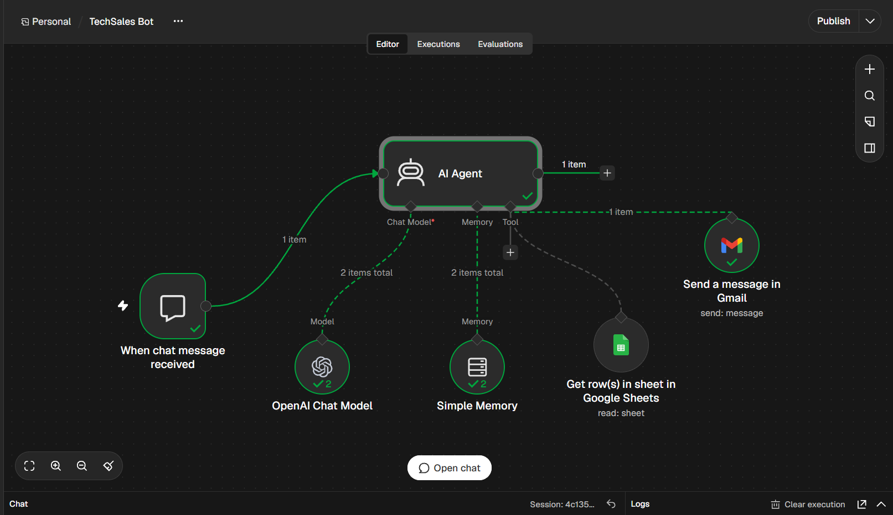
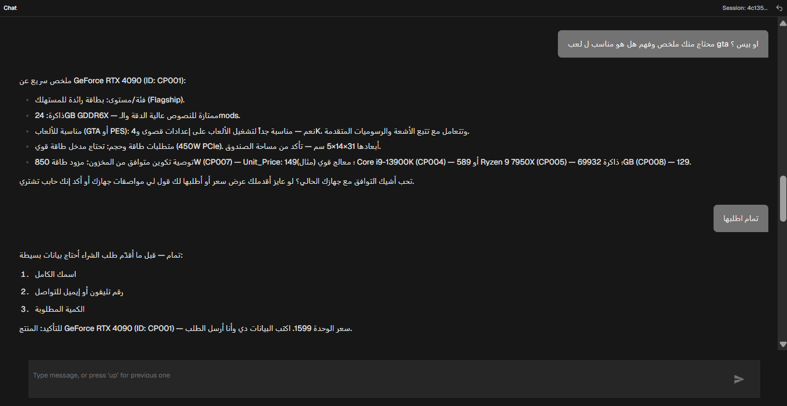

# Tech Sales Bot

An AI sales assistant for a computer hardware store (GPUs, CPUs, and more). Customers chat with the bot, which looks up products in a live Google Sheets inventory, answers questions about availability, prices, and specs, and emails the store owner a formatted purchase request once the customer confirms an order.

## Workflow

## Demo

## How It Works

1. **Chat Trigger** receives the customer's message.
2. **AI Agent** decides what to do, using a system prompt with clear rules.
3. **Google Sheets tool** looks up the inventory. The agent always checks the sheet before answering any product question, so it never invents items or prices.
4. **Simple Memory** keeps the recent conversation (last 50 messages) so the customer can refer back to earlier messages.
5. **Gmail tool** sends a purchase request email to the store owner, but only after the customer explicitly confirms they want to buy.

## Features

- Answers questions about products, prices, warranty, and availability from real inventory data.
- Suggests the closest alternative when an item is not available.
- Shows at most 5 items per answer to keep replies short.
- Replies in the customer's language (works with Arabic and English).
- Collects the required order details before sending anything: customer name, product, quantity, and at least one contact method (phone or email).
- Calculates the order total (unit price x quantity).
- Sends the owner a clean HTML email with the customer and order details.
- Never emails the owner for simple questions or price inquiries.

## Tools Used

- **n8n** (AI Agent, Chat Trigger, Simple Memory)
- **OpenAI Chat Model** (`gpt-5-mini`), accessed through [SovereignEG](https://backend.sovereigneg.com), an Egyptian OpenAI-compatible API provider
- **Google Sheets** (inventory)
- **Gmail** (purchase request emails)

## Inventory Sheet

The agent reads from a Google Sheet with one product per row. The columns it relies on:

| Column | Description |
|--------|-------------|
| `Device_ID` | Unique product ID |
| `Device_Name` | Product name |
| `Model` | Model name or number |
| `Manufacturer` | Brand |
| `Unit_Price` | Price per unit |
| `Warranty_Years` | Warranty length |

You can add more columns (for example category or specs). The agent shows them when the customer asks for those details.

## How to Import

1. Download [`workflow.json`](./workflow.json).
2. In n8n, open the menu (top right) and choose **Import from File**.
3. Connect your credentials in these nodes:
   - **OpenAI Chat Model**: your API key (and a custom Base URL if you use an OpenAI-compatible provider).
   - **Google Sheets**: your Google account.
   - **Gmail**: your Google account.
4. In the **Google Sheets** node, select your own inventory sheet.
5. In the **Gmail** node, replace `owner@example.com` with the store owner's email.
6. Open the chat (**Open chat** button in n8n) and try it.

## Example Conversation

- *"Do you have any 850W power supplies?"* The bot searches the sheet and lists matching items with price and warranty.
- *"I want to order one of those."* The bot asks for your name, quantity, and a phone or email.
- Once everything is confirmed, the owner receives an email with the customer and order details, and the bot confirms to the customer that the request was placed.

## Notes

- This project was built for learning and practice.
- Credentials are not included in the exported workflow. Add your own after importing.
- The inventory data is sample data only.