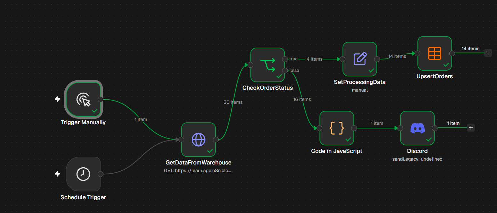
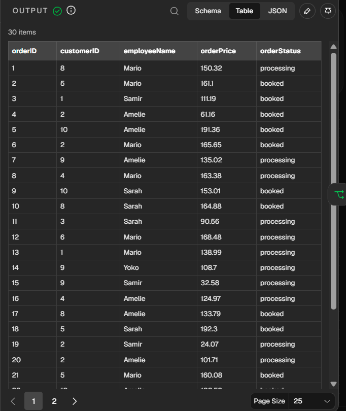
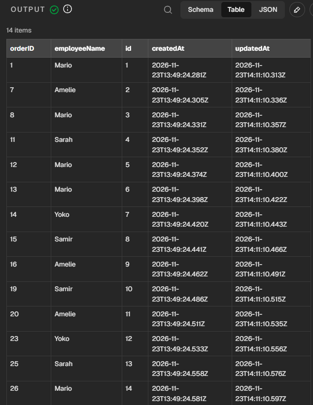
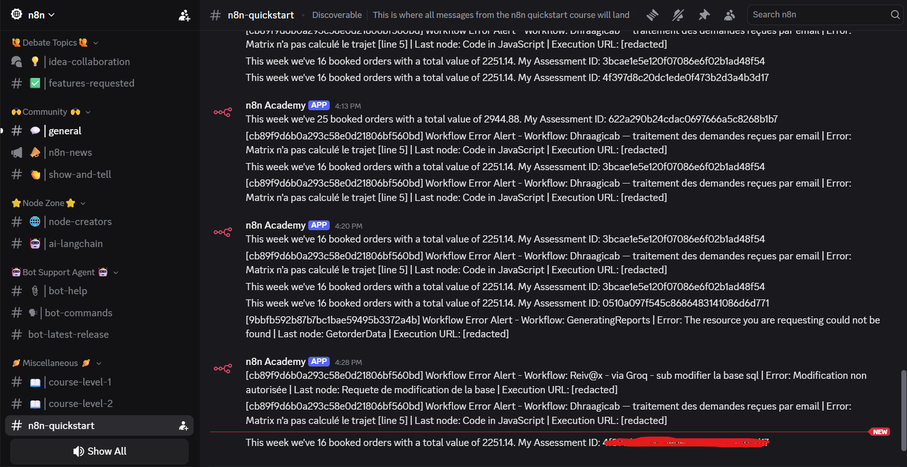
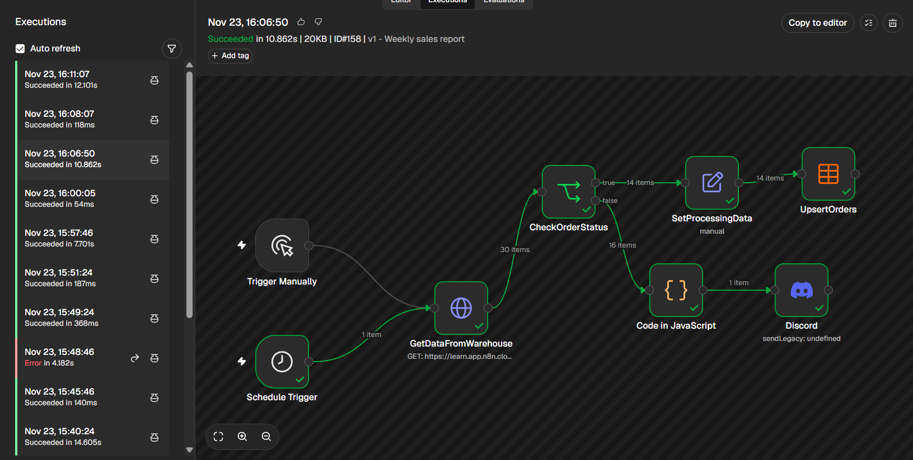

# n8n Weekly Sales Report

An automated weekly sales report built with [n8n](https://n8n.io). Every Monday at 9 AM it pulls orders from a legacy data warehouse API, posts the total of **booked** orders to Discord, and saves the **processing** orders to a Data Table for follow-up.

> **Note:** This is a learning project built while following the **n8n Quickstart course**. The scenario (Nathan, ABCorp) and the API endpoints come from the course.



## The Problem

Every week, an analytics manager had to:

1. Collect sales data from an in-house data warehouse with no CSV export.
2. Sum all `booked` orders and announce the total in Discord.
3. Build a table of all `processing` orders so sales managers could follow up with customers.

Doing this by hand is repetitive and error-prone: a mistyped number or a missed deadline is easy to make.

## The Solution

An n8n workflow that does all of it automatically, on a schedule, with no manual calculation.

## How It Works

| # | Node | Type | What it does |
|---|------|------|--------------|
| 1 | **Schedule Trigger** | Schedule | Runs every Monday at 9 AM (`Africa/Cairo` timezone) |
| 2 | **Trigger Manually** | Manual Trigger | Lets me run the workflow on demand while testing |
| 3 | **GetDataFromWarehouse** | HTTP Request | `GET` request to the warehouse API using Header Auth |
| 4 | **CheckOrderStatus** | If | Splits orders: `processing` goes to the `true` branch, everything else to `false` |
| 5 | **SetProcessingData** | Edit Fields (Set) | Keeps only `orderID` and `employeeName` |
| 6 | **UpsertOrders** | Data Table | Upserts the processing orders into the `processingOrders` table, matching on `orderID` (no duplicates on re-runs) |
| 7 | **Code in JavaScript** | Code | Counts the booked orders and sums their `orderPrice` |
| 8 | **Discord** | Discord (Webhook) | Posts the booked-orders summary to the channel |

```
Schedule Trigger ──┐
                   ├─► GetDataFromWarehouse ─► CheckOrderStatus ─┬─ true ──► SetProcessingData ─► UpsertOrders
Trigger Manually ──┘                                              └─ false ─► Code in JavaScript ─► Discord
```

### Example Discord message

```
This week we've 18 booked orders with a total value of 12345.67.
```

## Screenshots

| Warehouse output | Processing orders table |
|---|---|
|  |  |

| Discord message | Successful execution |
|---|---|
|  |  |

## Tech Stack

- **n8n** (workflow automation)
- **HTTP Request** node with Header Auth credentials
- **n8n Data Tables** (built-in storage, no external account needed)
- **Discord** webhook
- **JavaScript** (Code node)

## How to Use

1. Import `workflow.json` into n8n (**Workflows → Import from file**).
2. Create a Data Table named `processingOrders` with these columns:

   | Column | Type |
   |---|---|
   | `orderID` | Number |
   | `employeeName` | String |

3. Open the **UpsertOrders** node and select your `processingOrders` table.
4. Open **GetDataFromWarehouse** and set up your own credentials:
   - Create a **Header Auth** credential with your API key.
   - Replace `YOUR_ASSESSMENT_ID` in the `x-assessment-id` header with your own value.
5. Open the **Discord** node, create a **Webhook** credential, and paste your own webhook URL (`YOUR_WEBHOOK_URL`).
6. Set the workflow **Timezone** in *Settings* to your own.
7. Click **Execute workflow** to test, then **Publish** to run it on schedule.

## What I Learned

- Calling APIs that have no dedicated node using the **HTTP Request** node and credentials.
- Branching data with the **If** node and shaping it with **Edit Fields**.
- Using **Upsert** with a match condition so re-running a workflow doesn't create duplicates.
- Writing a small **Code** node to aggregate data.
- Scheduling, publishing, and monitoring workflows through **Executions** and **Workflow Settings**.

## Credits

Built as part of the **n8n Quickstart course**. The ABCorp scenario and warehouse API belong to the course.
